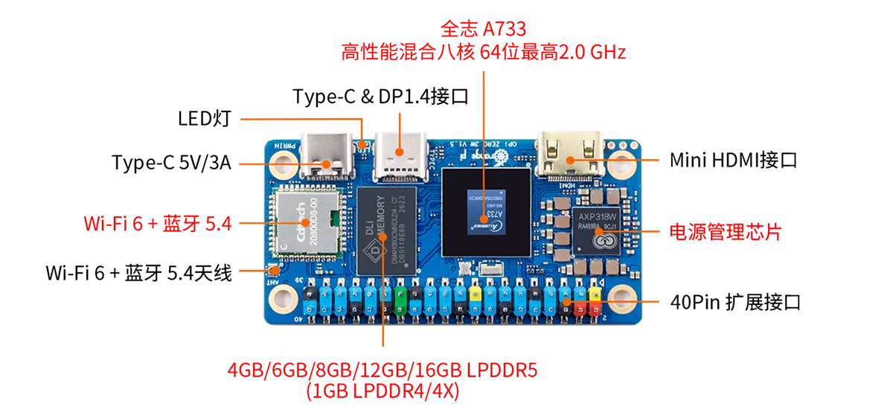

# opz3w-dev Software Repository


**AI agents: read `AGENT.md` first** — board rules, build/deploy patterns
and known pitfalls. Development repository for the Orange Pi Zero 3W
(Allwinner A733, DynamIQ octa-core: 2x Cortex-A76 @ up to 2.0 GHz +
6x Cortex-A55 @ up to 1.794 GHz, 1 GiB LPDDR4) running **Armbian
community 26.11.0-trunk.123** (Ubuntu "resolute" base, vendor kernel
`6.6.98-vendor-sun60iw2`, arm64). Rootfs on a 30 GB TF card, zram swap.
No display output and **no Ethernet** - everything happens over WiFi /
serial.



Connector close-ups live in [board_images/](board_images/).

## Board connection (verified working)

- Windows: `ssh opz3w` - alias in `C:\Users\user1\.ssh\config`
  (`orangepizero3w.local`, user `root`, key `id_rsa_pocket`). mDNS
  resolution works on Windows, passwordless login is set up.
- WSL: same alias `opz3w` in `~/.ssh/config`, but with the **numeric
  IP** (currently `192.168.5.79`, the `wlan0` WiFi address) - WSL2 does
  not resolve mDNS `.local` names. The private key is already in
  `~/.ssh/id_rsa_pocket` (0600); `/mnt/c/...` copies are rejected by
  Linux ssh (permissions). The DHCP lease can move - run
  `tools/find_board.sh` to rescan and rewrite the alias.
- Login: **root**, passwordless (key installed; sudo is not needed on
  the board - we log in as root).
- Serial console: debug header, 115200 8N1 - Extension pin 6 = GND,
  pin 8 = UART0_TX, pin 10 = UART0_RX - rescue access when WiFi is
  gone.

Vendor docs (A733 user manual, schematics, tools) live in
`D:\board_database\orangepi-zeo3w` and are **not** part of this repo
(see `docs/README.md`).

## Toolchain (verified end-to-end)

The A733 is a 64-bit Cortex-A76/A55 SoC - unlike the old Orange Pi Zero
(H2+, armv7) this board needs the **aarch64** cross compiler:

```
sudo apt install gcc-aarch64-linux-gnu    # GCC 15.2.0, aarch64
```

Installed in WSL as `aarch64-linux-gnu-gcc`; `env.sh` only exports the
prefix and the ssh alias. The board also has native
`gcc`/`make`/`rsync`/`python3` (the `build-remote` target in each app's
Makefile uses it).

Cross build + fast deploy loop (from `app/<project>/`):

```
make push    # cross-compile and rsync the binary
make run     # execute it on the board
make deploy  # push sources too (for remote builds)
```

Debugging: printf so far; `gdbserver` can be installed on the board via
apt if needed.

## Board facts (verified)

| Item | Value |
|---|---|
| SoC | Allwinner A733 (sun60iw2): 2x Cortex-A76 @ max 2002 MHz (cpub cluster) + 6x Cortex-A55 @ max 1794 MHz (cpul cluster), 416 MHz min |
| RAM | 825 MiB visible (1 GiB part), zram swap |
| Storage | TF card rootfs (`mmcblk1`), no eMMC |
| Network | WiFi only, interface `wlan0` (DHCP, currently 192.168.5.79) - no Ethernet port |
| LED | single `status_led` (gpio-leds, high active), boots with trigger `heartbeat`, free for apps |
| Temperature | `/sys/class/thermal/`: zone0 `cpub` (A76 pair), zone3 `cpul` (A55 six), zone1 ddr, zone2 npu, zone4 gpu - millidegrees C |
| PWM | 3 controllers (`pwmchip0/10/20`), 10 channels each; PWM0_0..9 land on the JP4 40-pin header |
| GPIO/I2C/SPI | JP4 40-pin header (TWI0-3, SPI3, UART2/6/7, PWM0_x) - full table in `D:\board_database\orangepi-zeo3w\README.md` |

LED control: `echo heartbeat > /sys/class/leds/status_led/trigger` or
`echo 1 > .../brightness` - the nodes are root-owned 0644, but we ssh
in as root so it just works (no udev rule needed while there is no
non-root user on the board).
